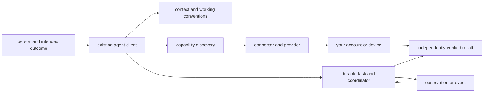

# pagi

**personal agi, piece by piece.**

a modular agent harness for your own accounts, devices and agents.

pagi is a way to assemble a personal agent system around useful outcomes: find
something in your messages, arrange a meeting, keep a task through a disconnect,
or return with a verified result. start with one component and keep your current
agent client. add context, tools, coordination and devices when the outcome needs
them.

“personal agi” names the direction. this repository does not claim general
intelligence, autonomous access to every service, or a finished universal product.
the first release is a system map, component catalog and operating contracts.
individual implementations live in their source repositories.



## find your entry

| what you want | start here |
| --- | --- |
| understand what the system does | [functional view](docs/views/functional.md) |
| understand its value and product boundaries | [product view](docs/views/product.md) |
| understand the human experience | [usability view](docs/views/usability.md) |
| understand protocols, ownership and composition | [technical view](docs/views/technical.md) |
| deploy, observe, update or recover it | [infrastructure view](docs/views/infrastructure.md) |
| let an agent navigate or contribute | [agent entry](AGENTS.md) and [agent operating guide](docs/agents.md) |
| choose a component for your own setup | [component map](docs/components.md) and [adoption guide](docs/adoption.md) |

## the pieces

| piece | purpose | source and present boundary |
| --- | --- | --- |
| telegram mcp | bounded reads and guarded actions in chats, groups and topics | [tg-mcp-guarded](https://github.com/matskevich/tg-mcp-guarded), public provider |
| whatsapp mcp | message context and provider-specific operations | [whatsapp-mcp](https://github.com/matskevich/whatsapp-mcp), private source |
| agent connectors | capability catalog, browser/android adapters, tasks, orchestration and watches | [agent-connectors](https://github.com/matskevich/agent-connectors), private source |
| operations and skills | task conventions, context retrieval and delegated follow-through | [dima-ops](https://github.com/matskevich/dima-ops), private source |
| shared infrastructure conventions | credential runtime, deployment and source access patterns | [meta](https://github.com/matskevich/meta), private source |
| media and home device bridge | device stages and media preparation | [bali-transcript-mcp](https://github.com/matskevich/bali-transcript-mcp), private source |
| domain work | content production is one consumer of the harness | [contentOS](https://github.com/matskevich/contentOS), private source |

private links require access and may return 404. they identify source ownership,
not a publicly installable dependency. this repository grants no access to those
repositories, accounts, deployments or data. use the public telegram provider's
own recipe if you want an available first component today.

the [machine-readable catalog](registry/components.json) also separates linear
projections, notifications, payments, context and voice. related does not mean
required. a telegram reader does not need a coordinator or a payment account.

```sh
python3 tools/catalog.py list
python3 tools/catalog.py show telegram
python3 tools/catalog.py plan orchestration notifications
python3 tools/catalog.py check
```

these standard-library commands inspect local metadata. they do not install,
authenticate, contact a service, execute a recipe or spend money.

## a useful result has a receipt

an accepted request, a successful tool call and a completed human outcome are
different states. keep the original goal and authority, observe the real effect,
and reconcile an unknown write before repeating it. task state should survive
process and device loss. [contracts and examples](docs/contracts.md) describe the
interfaces without claiming every linked implementation already conforms.

## build in the open without exporting a private life

pagi publishes new general documentation, schemas, synthetic examples and small
inspection tools. private correspondence, relationship models, real task records,
sessions, account identifiers and deployment credentials belong to each person's
installation. components keep their own maintainers, histories and licenses.

read [current status](docs/status.md), [release boundaries](docs/releasing.md) and
[roadmap](docs/roadmap.md) before promising an installation. new material in this
repository is [mit licensed](LICENSE). linked components retain their own terms.
personal agi, piece by piece — a modular agent harness for your own accounts, devices and agents
