# development, personal profiles and public releases

recommended model, 2026-11-26. the public hub exists. the shared lab, contributor
access and periodic promotion below are a design, not an installed service.

## three spaces, two code lanes

| space | intended audience | contents | update style |
| --- | --- | --- | --- |
| personal overlay | one installation's owner and authorized agents | preferences, authority references, private evidence and configuration | whenever personal work changes |
| shared lab | explicitly admitted collaborators | reusable development, experimental skills and sanitized cases | frequent commits, branches and previews |
| public aiki | anyone | selected stable modules, contracts, synthetic examples and recipes | reviewed versioned promotion |

the two code lanes are development and distribution. the personal overlay
configures a chosen version instead of maintaining a fork of the same code.
existing providers keep their source ownership and licenses. a lab coordinates
changes without becoming a second implementation of every provider.

the personal overlay need not become another monorepo. existing private
operations/domain repositories can hold its rules and references. credentials,
sessions and raw evidence stay in protected installation-local stores.

## one source owner per piece

each component has an owning source, compatibility contract and release path.
shared improvements go to that source. personal settings stay in the overlay.
public code is a reviewed distribution of selected work, not another branch to
maintain by hand. public contributor fixes return to the owning source before
the next export.

a lab entry might organize `components/`, `skills/`, `cases/`, `learning/` and
`releases/`. these contain references or owned reusable material, not copies of
every provider or private case archive.

before inviting collaborators, review repository history and permissions. a clean
current checkout does not make old private history appropriate to share. begin a
new shared lab with a deliberate clean export, not a fork of a personal deployment
repository. no existing private repository is made collaborator-ready by this doc.

## personal preferences and shared learning

separate capability, authority and interaction preference. a personal preference
cannot widen provider permissions or supply a spending mandate. another adopter
can choose a different attention, language or confirmation profile without
forking the implementation.

| lesson | destination | evidence |
| --- | --- | --- |
| reproducible technical mechanism | provider or small shared skill | focused scenario and regression check |
| contextual workflow | lab recipe or domain skill | applicability, limits and observed usefulness |
| general judgment principle | shared working conventions | mechanism, counterexample and transfer beyond one case |
| individual preference | private personal profile | the person's stated choice and scope |

one incident need not produce a new skill. a bug fix, an existing rule applied
properly, a known limitation or a discarded hypothesis may be the better outcome.
avoid accumulating unconditional instructions from every edge case.

```mermaid
flowchart LR
    actual[real outcome and source] --> private[private originating case]
    private --> sanitized[sanitized mechanism and result]
    sanitized --> lab[shared lab case]
    lab --> classification[technical / contextual / general / personal]
    classification --> experiment[small reversible change]
    experiment --> observation[next comparable outcome]
    observation --> candidate[release candidate or private profile update]
```

raw evidence remains with its authorized owner. code collaboration does not
authorize sharing correspondence or another person's private information.
shared cases retain the minimum source-independent mechanism and limits. see
the [synthetic learning record](../examples/learning-record.json).

an agent can collect and deduplicate cases, distinguish observation from
hypothesis, propose a focused change, test it and retain its actual outcome.
the person supplies a missing preference or consequential decision when needed.
routine issue gardening need not become the owner's management job.

public learning material contains generalized mechanisms and synthetic
reproductions. private source links and personal profiles are not exported.
security-sensitive findings can be fixed privately before a general explanation.

## fast development with a small baseline

the lab can accept unfinished experiments, terse notes and frequent changes.
each commit need not pass the full public release process. real credentials,
sessions and private evidence still stay out of shared source. contributor code
is tested without the maintainer's live accounts. installing shared software
does not grant access to the maintainer's infrastructure.

adopters can choose a pinned development preview or stable release. updates
preserve their profiles and local state. experiments do not automatically replace
working production services.

## curated public promotion

select useful changes, not everything older than a date. public releases can lag
development by weeks. a month's age alone proves neither portability nor privacy.

1. select source revisions and an explicit export list privately.
2. separate installation configuration and personal policy from reusable code.
3. build a clean candidate tree without private history or private provenance.
4. check secrets, personal identifiers, licenses, dependencies and package contents.
5. exercise the advertised scenario in an isolated installation and check the
   relevant restart, update and rollback boundaries.
6. prepare a public change with version, compatibility and sanitized evidence.
7. merge a passing candidate, verify the artifact and keep the source-to-public
   mapping in the private release ledger.

public history accumulates reviewed releases normally. never merge private git
history wholesale into the public repository. improve the owning source instead
of repeatedly maintaining hand-edited export variants.

a future weekly job can compare revisions and prepare a candidate when material
changes. unchanged sources require no model review. scheduled preparation and
permission to publish are separate. this document enables no scheduler.

the public hub's file-policy and secret-scanning checks cover its own files.
they are not yet a private-to-public publisher or a complete security assessment
of linked modules. scans and tests reduce risk but cannot prove absence of every
vulnerability. live authorization must hold even when the general mechanism is
understood publicly.

## collaboration and contribution rights

start with named collaborators, no administration rights and one accountable
maintainer. select read versus write access deliberately. personal-account
private repositories grant collaborators write access. organization repositories
support more granular roles. choose the organization and plan before implementing
a read-only lab. see [personal repository permissions](https://docs.github.com/en/repositories/managing-your-repositorys-settings-and-features/repository-access-and-collaboration/permission-levels-for-a-personal-account-repository)
and [organization roles](https://docs.github.com/en/organizations/managing-user-access-to-your-organizations-repositories/managing-repository-roles/repository-roles-for-an-organization).

agree once how lab contributions may appear in later public releases. private
access alone does not establish a maintainer's right to relicense another
contributor's work. preserve third-party terms. putting all lab material under
mit immediately permits recipients to redistribute that licensed material.
access restrictions and release embargoes therefore need deliberate terms.
see the [mit license](https://opensource.org/license/mit).
